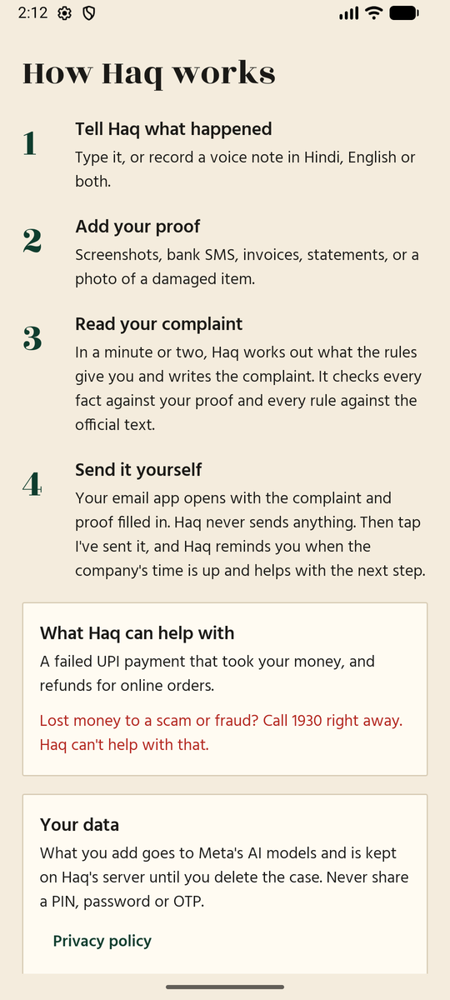

# How to use Haq

Haq helps you get back money a company owes you in India. You tell it what happened and show your
proof. It works out what the rules give you and writes the complaint, and you send it yourself.

**Haq can help with:**

- a failed UPI payment that took money from your account and did not give it back
- a refund for an online order: damaged, defective, wrong item, late or not delivered

**Haq can't help with:**

- Scams and fraud. Call **1930** at once and report at <https://cybercrime.gov.in>.
- Money you sent to the wrong person, where the payment itself went through.
- Things bought in a physical shop. Call the National Consumer Helpline on **1915**.

Flight cancellations and delays are planned but not ready yet.

## Your first case

1. **Tell Haq what happened.** Tap **Start a new case**, then type what happened, or record a voice
   note in Hindi, English or both. You can also share a screenshot or file to Haq from another app.
2. **Add your proof.** Add what you have: payment or order screenshots, bank SMS, invoices, PDF
   statements, chats with customer support, or a photo of a damaged item. More proof helps, because
   anything without proof goes in the complaint as your own statement.
3. **Enter your name** as it is on your account or order. Haq signs your complaint with it.
4. **Tap Get my money back** and wait a minute or two. You can leave the app while it works.
5. **Answer any question.** If Haq needs something more, it asks you. Type or record your answer.
6. **Read your complaint.** Haq checks every fact against your proof and every rule against the
   official text, but it can still make mistakes. If something is wrong, don't send it.
7. **Send it yourself.** **Send by email** opens your email app with the complaint and proof filled
   in. Add the company's address and send it. Haq never sends anything for you. **Copy** gives you
   the text to paste into a company's form or chat instead.
8. **Tap I've sent it.** Haq starts counting the company's time to reply and reminds you when it runs
   out, so allow notifications.

## After you send it

When the reminder comes, or any time before, open the case and answer **Has this been fixed?**

- **Yes, it's fixed** closes the case.
- **No, not fixed** makes Haq look at your next step. If the company still has time, Haq keeps
  waiting and tells you until when. If its time is up, Haq prepares the next complaint: to the RBI
  Ombudsman for a UPI payment, or the National Consumer Helpline for an online order.

## Damage photos

For a damaged item, Haq may add a copy of your photo with a red box around the damage. The box is
made by AI and can be wrong, so check it. If it is wrong, remove that copy from your email before you
send it. Your original photo is attached too.

## Your data

- There is no account. Your cases are tied to this phone's copy of the app.
- **Delete your cases in the app before you uninstall it.** After uninstalling or clearing the app's
  data, you can't reach them any more.
- A case with no activity for 180 days is deleted automatically.
- What you add goes to Meta's AI models and is stored on Haq's server until the case is deleted.
- Never share a PIN, password or OTP. If you can, cover card and Aadhaar numbers before adding a file.

The [privacy policy](PRIVACY.md) has the details.

## If something goes wrong

| What you see | What to do |
|---|---|
| A connection error | Check your internet, then tap **Refresh** on the home screen |
| Interrupted | Open the case and tap **Try again**. Your case and proof are saved |
| No email app found | Tap **Copy** and paste the complaint into any email app |
| No reminder came | Check that notifications are allowed for Haq, and put the date in your calendar |

## Good to know

Haq is not a lawyer and does not give legal advice, and it can't promise you'll get your money back.
It helps you use the official complaint channels yourself.
